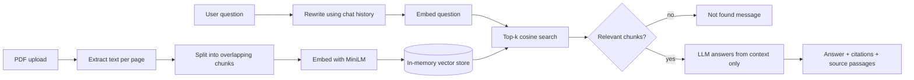

# 📚 Intelligent Multi-Document RAG Assistant

A Retrieval-Augmented Generation (RAG) web app. Upload several PDF reports, ask questions in plain
English, and get answers **grounded in your documents** with **file + page citations**. If the answer
is not in the documents, the assistant says so instead of guessing. Follow-up questions work because
the chat history is used to understand what you mean.

**Live demo:** _add your Streamlit link here_

---

## 1. Problem statement
Organisations keep knowledge in many long documents (annual reports, policies, manuals). Finding one
fact means manually searching through several files. This project lets users upload multiple PDFs and
query them conversationally, with every answer traceable to its source.

**Requirements covered**

| Requirement | How it is met |
|---|---|
| Upload multiple PDFs | Multi-file uploader; each file indexed separately |
| Natural-language Q&A with an LLM | Retrieved passages are sent to an LLM (Groq `gpt-oss-120b`) |
| Grounded answers | System prompt restricts the LLM to the retrieved context |
| Source references | Inline `[file.pdf, p.N]` citations + expandable source passages |
| Handle unavailable information | Relevance threshold + explicit "not found" response |
| Conversational context | Follow-ups are rewritten into standalone questions using chat history |

## 2. Approach



1. **Ingestion:** `pypdf` extracts text page by page, so every chunk keeps its file name and page number.
2. **Chunking:** ~900-character chunks with 150 characters of overlap, cut at sentence boundaries where possible.
3. **Embeddings:** `sentence-transformers/all-MiniLM-L6-v2` (free, runs on CPU), vectors normalised.
4. **Retrieval:** cosine similarity over a NumPy matrix (top-k, default 5). The first chunk of each matched document is also included, which helps title/author questions.
5. **Generation:** the LLM is told to answer only from the labelled context, cite sources, and reply with a fixed "not found" sentence otherwise.
6. **Memory:** the last 6 messages are sent to the LLM; a follow-up such as "and the previous year?" is first rewritten into a standalone question so retrieval still works.

Full design notes: [docs/DESIGN.md](docs/DESIGN.md)

## 3. Tech stack
Python 3.12 · Streamlit · pypdf · sentence-transformers · NumPy · Groq API (`openai/gpt-oss-120b`)

## 4. Project structure
```
rag_app/
├── app.py                 # Streamlit UI (upload, chat, sources)
├── rag.py                 # Core RAG logic (no UI code)
├── requirements.txt       # Dependencies (CPU-only torch for free hosting)
├── README.md
├── .streamlit/
│   └── secrets.toml.example   # Template for the API key
├── sample_documents/      # Dataset: 3 synthetic PDF reports + generator script
├── docs/
│   ├── DATASET.md         # Dataset source and licensing
│   ├── DESIGN.md          # Design decisions, limitations
│   └── TEST_QUESTIONS.md  # Demo questions with expected answers
└── tests/
    └── test_rag.py        # Offline unit tests
```

## 5. Dataset
The project ships with three **synthetic, fictional** reports in `sample_documents/` (an energy company
annual report, a retail financial report, a plant operations manual). You can also use any real public
PDFs, such as annual reports from company investor pages or SEC EDGAR filings.
See [docs/DATASET.md](docs/DATASET.md) for sources and licensing.

## 6. Setup
Requires Python 3.10+ and a free Groq API key from <https://console.groq.com> (API Keys).

```bash
git clone https://github.com/pyatacharanteja/rag_app.git
cd rag_app
pip install -r requirements.txt
```

Provide the key in **one** of these ways:
- Copy `.streamlit/secrets.toml.example` to `.streamlit/secrets.toml` and fill in the key, or
- Set an environment variable: PowerShell `$env:GROQ_API_KEY="gsk_..."`, macOS/Linux `export GROQ_API_KEY=gsk_...`, or
- Paste it into the app sidebar at runtime.

## 7. Run
```bash
python -m streamlit run app.py
```
Open <http://localhost:8501>, upload PDFs (try `sample_documents/`), click **Process documents**, and ask questions.
The first run downloads the ~90 MB embedding model.

Example questions and expected answers: [docs/TEST_QUESTIONS.md](docs/TEST_QUESTIONS.md)

## 8. Tests
```bash
pip install pytest reportlab
pytest -q
```
The tests run offline using a stand-in embedder and LLM; they check page extraction, chunking,
multi-document ingestion, citations, follow-up handling, "not found" behaviour and re-upload.

## 9. Deploy (free)
1. Push the repo to GitHub.
2. On <https://share.streamlit.io> create an app: repo `rag_app`, branch `main`, file `app.py`, Python 3.12.
3. In **Advanced settings → Secrets** add `GROQ_API_KEY = "gsk_..."` (or leave blank so visitors paste their own key).

## 10. Limitations and future work
- Scanned/image-only PDFs have no extractable text (OCR is not included).
- The index lives in memory and is lost when the session ends; add a persistent vector DB (FAISS/Chroma) for permanent storage.
- Tables in PDFs are extracted as plain text, so complex tables may lose structure.
- Possible upgrades: hybrid keyword + semantic search, a re-ranker, streaming answers, answer-quality evaluation.
